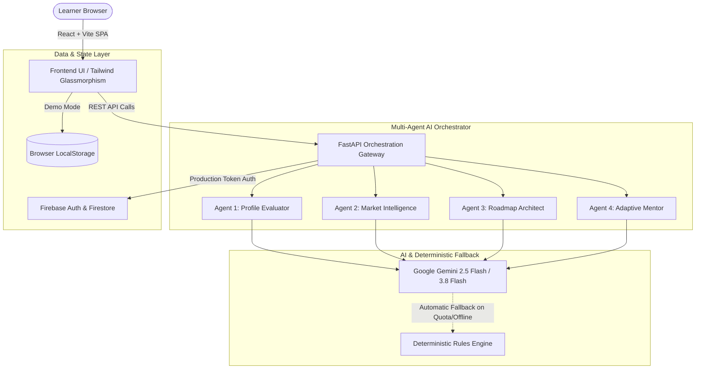

# HIGH LEARNER

HIGH LEARNER is an AI-powered personalized career development platform that uses four specialized AI agents to analyze learner skills, identify career gaps, generate adaptive learning roadmaps and provide personalized AI mentoring.

[](https://fastapi.tiangolo.com/)
[](https://react.dev/)
[](https://tailwindcss.com/)
[](https://ai.google.dev/)
[](LICENSE)

---

## 🎯 Problem Statement
Career transitions into tech are filled with fragmented information, generic tutorials, and lack of clarity on exact industry skill requirements. Learners often waste hundreds of hours studying out-of-date concepts without knowing their readiness score or what exact skills are missing for their target career role.

## 💡 The Solution
**HIGH LEARNER** orchestrates four autonomous AI specialist agents powered by Google Gemini to provide a hyper-personalized, closed-loop career acceleration experience:
1. **Profile Evaluator Agent**: Extracts and standardizes verified candidate capabilities, years of experience, and project evidence.
2. **Market Intelligence Agent**: Compares candidate proficiency against real-time industry benchmarks across 5 key tech roles (Full Stack Developer, Data Scientist, DevOps Engineer, Cloud Architect, Mobile App Developer).
3. **Roadmap Architect Agent**: Designs an ordered, prerequisite-aware syllabus with curated resources and concrete hands-on projects.
4. **Adaptive Mentor Agent**: Evaluates real interactive knowledge assessments, identifies micro-concept deficiencies, and adjusts learning recommendations adaptively in real time.

---

## 🏗️ System Architecture



---

## 🌟 Key Features

- **Multi-Agent AI Pipeline**: Four specialist agents collaborating asynchronously to evaluate readiness and generate customized paths.
- **Interactive Knowledge Assessment**: 5-question JavaScript & CS assessment with strict server-side answer key validation (never exposes answers to client).
- **Adaptive Learning Logic**:
  - Score < 60%: Automatic beginner revision recommendations and prerequisite reinforcement.
  - Score 60% – 80%: Intermediate practice exercises and targeted weak-concept remediation.
  - Score > 80%: Roadmap acceleration and real-world practical capstone challenges.
- **Context-Aware AI Mentor**: Streaming chat assistant grounded in the learner's actual profile, current module, and assessment history.
- **Glassmorphic UI/UX**: Fluid edge-to-edge layout, responsive quick dock, interactive metrics, and accessible color contrast.
- **Zero-Friction Demo Mode**: Instant one-click Alex Johnson sample profile loading without requiring external database accounts.

---

## 🛠️ Tech Stack

### Frontend
- **Framework**: React 18 with Vite
- **Styling**: Tailwind CSS, PostCSS, Lucide React Icons
- **Data Visualization**: Recharts (radar charts, proficiency bars)
- **Deployment**: Vercel SPA (`vercel.json`)

### Backend
- **Framework**: FastAPI (Python 3.12)
- **Server**: Uvicorn (ASGI)
- **AI Models**: Google Gemini (`google-genai` SDK)
- **Validation**: Pydantic v2
- **Testing**: Python `unittest` / `pytest`
- **Deployment**: Render Web Service (`render.yaml`, `Procfile`)

---

## 📁 Project Structure

```
HIGH-LEARNER/
├── backend/
│   ├── agents/                  # The 4 Autonomous AI Agent Implementations
│   │   ├── analyzer.py          # Profile Evaluator Agent
│   │   ├── market.py            # Market Intelligence Agent
│   │   ├── roadmap.py           # Curriculum & Roadmap Architect Agent
│   │   └── mentor.py            # Adaptive Mentor Agent
│   ├── services/
│   │   ├── gemini.py            # Gemini API Client & Fallback Orchestration
│   │   ├── assessment.py        # Server-side Assessment & Grading Logic
│   │   ├── firebase_auth.py     # Firebase Token Verification
│   │   └── firestore.py         # Firestore Collections & CRUD
│   ├── tests/                   # 22 Comprehensive Unit & Integration Tests
│   ├── main.py                  # FastAPI Application Routes & CORS
│   ├── requirements.txt         # Python Dependencies
│   ├── Procfile                 # Deployment Procfile for Render/Heroku
│   └── .env.example             # Backend Environment Template
├── frontend/
│   ├── src/
│   │   ├── components/          # Layout, Sidebar, Header, ChatBox, Modals
│   │   ├── pages/               # Dashboard, Roadmap, Assessment, Progress, Onboarding
│   │   ├── services/            # Axios API Gateway Service
│   │   ├── context/             # Global Auth & Profile State
│   │   └── index.css            # Tailwind & Glassmorphism Theme
│   ├── package.json
│   ├── vite.config.js
│   ├── vercel.json              # Vercel SPA Routing Configuration
│   └── .env.example             # Frontend Environment Template
├── firebase/
│   └── firestore.rules          # Strict User-Scoped Firestore Security Rules
├── render.yaml                  # Infrastructure as Code for Render Web Service
├── test_e2e.py                  # Complete 15-Step Automated End-to-End Verification
├── .gitignore                   # Safe Git Ignore (No secrets, no virtualenvs)
└── README.md
```

---

## 🚀 Quick Start & Local Setup

### Prerequisites
- Node.js 18+ & npm
- Python 3.10+
- Google Gemini API Key ([Google AI Studio](https://aistudio.google.com/))

### 1. Backend Setup
```bash
# Navigate to backend directory
cd backend

# Create and activate virtual environment
python -m venv venv
# On Windows:
.\venv\Scripts\activate
# On Linux/macOS:
source venv/bin/activate

# Install dependencies
pip install -r requirements.txt

# Configure environment
cp .env.example .env
# Edit .env and insert your GEMINI_API_KEY

# Run the FastAPI server
uvicorn main:app --reload --host 0.0.0.0 --port 8000
```
Backend health check: `http://localhost:8000/api/health`

### 2. Frontend Setup
```bash
# Navigate to frontend directory
cd frontend

# Install dependencies
npm install

# Configure environment
cp .env.example .env

# Run development server
npm run dev
```
Open `http://localhost:5173` in your browser.

---

## 🧪 Testing & Verification

### Running Backend Unit Tests (22 tests)
```bash
cd backend
python -m unittest discover backend/tests
```

### Running Frontend Build Verification
```bash
cd frontend
npm run build
```

### Running 15-Step End-to-End Verification
```bash
python test_e2e.py
```

---

## 🔒 Security & Best Practices

- **Zero Secret Exposure**: `.gitignore` strictly ignores `.env`, service account credentials, and temporary caches.
- **Server-Side Grading**: Assessment answers are strictly held in backend memory; client receives only scores and pedagogical feedback.
- **Secure Token Derivation**: When Firebase is enabled, user identities are derived from cryptographically verified tokens, never client-submitted IDs.
- **Robust Deterministic Fallbacks**: Full resilience against network drops or Gemini rate limits without crashing.

---

## 📄 License
Distributed under the MIT License. See `LICENSE` for details.
